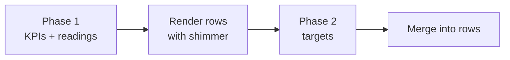

# 06 — KPI Timeline performance

## Why
The KPI Timeline is slow to load, and it will get much slower at the expected scale:

| Thing | Expected size |
|---|---|
| KPIs in the KPI space | ~40 |
| Work items carrying a KPI target ("contributing issues") | 1,000s |
| Work items underneath those that dates roll up from | 10,000+ |

The whole page is one backend call, `getTimelineData` → [buildTimelineData](../../app/src/backend/resolver.ts). It is a chain of dependent Jira requests, and several steps make **one request per item**. At this scale the per-item steps dominate.

This spec lists the improvements, ranked by impact at that scale, then gives an incremental plan with a way to verify each step.

### How the data is assembled today

| Step | What | Jira requests | Grows with |
|---|---|---|---|
| ① | Read KPI-space config (Forge storage) | 0–1 | – |
| ② | `GET /field` (rank field id), then JQL list of KPI issues | 1 + pages | KPIs |
| ③a | Reading changelog (`GET /field` again, then one bulk call) | 2 | – |
| ③b | `kpi-meta` property, one GET per KPI | N | **KPIs (~40)** |
| ③c | JQL for issues with `kpiIds IS NOT EMPTY`, paged sequentially | pages | **contributing issues** |
| ③d | `kpi-assignments` property, one GET per contributing issue, all fired at once | M | **contributing issues (1,000s)** |
| ③e | Parents not already loaded | batches | contributing issues |
| ④ | Download each issue-type icon | 1 per icon type | icon types |
| ⑤ | Walk the hierarchy for rolled-up due dates ([fetchSubtreeTimingNodesForRoots](../../app/src/backend/jira.ts)) | 2 per level per batch of 40 | **all descendants (10,000+)** |
| ⑥ | Assemble the tree in memory | 0 | – |

Steps ③a–③e run in parallel with each other. ④ and ⑤ wait for them, and ⑤ is itself one round per hierarchy level.

Two related problems elsewhere:

- `recordValue`, `addTarget` and `createKpi` each end with a full `buildTimelineData()`. Recording one value reloads everything.
- `buildPanelData` for a KPI issue also calls `buildTimelineData()` and then picks out one node. Opening one KPI's panel loads every KPI, target and rollup.

## Prioritized improvements (most impact first)

| # | Improvement | Why it ranks here |
|---|---|---|
| 1 | **Progressive loading**: show the KPIs and their readings first, load targets afterwards (§P4) | The best user experience, and it does not depend on any other fix. The page is usable as soon as the KPIs arrive, however slow the targets are. It also fixes the "lands on the oldest quarter" problem by opening the view on the current quarter. |
| 2 | **Fetch each issue's targets as part of the search, not one request per issue** (§P1) | Removes thousands of requests and one dependent step. The largest single backend cost at this scale. |
| 3 | **Prune the rollup walk using the rollup config** (§P2) | Stops descending where the config says children don't matter (for example Epic = "From Epic only"). Avoids most of the 10,000+ items. |
| 4 | **Only load children that can affect a date** (§P3) | Skips children with no due date. Applies to the leaf level only, so correctness is unchanged. |
| 5 | **Stop rebuilding everything on mutations and on the KPI issue panel** (§P5) | Every record, add-target, create-KPI and KPI panel open currently pays the full cost. |
| 6 | **Fold the child meta fields into the children query** (§P6) | Halves the requests per hierarchy level and enables #2 without an extra round. |
| 7 | **Shorten the critical path** (§P7): start independent work at t=0, one `/field` lookup, icons in parallel with the walk, drop the redundant parent fetch, start the request before the first render | Fewer waits in a row. Small gain per item, but cheap and safe. |
| 8 | **Fold `kpi-meta` into the KPI-space search** (§P8) | Removes about 40 GETs. Real but small next to #1. |
| 9 | **Page the contributing-issues search in parallel** (§P9) | Sequential paging of 1,000s of issues is many round trips in a row. |
| 10 | **Premium fast path with `portfolioChildIssuesOf`** (§P10) | Removes per-level rounds on Premium sites only. Needs a fallback, so it comes after the plan-agnostic fixes. |
| 11 | **Caching and pagination** (§Later) | Explicitly deferred. |

## Scope
**In:** backend request reduction and ordering, the config-aware rollup walk, progressive loading across resolver, hook and Timeline UI, and instrumentation to prove each change.

**Out for now:** result pagination and caching (see §Later). We make the page fast with limited data first, then decide how to page.

---

## P1. Fetch each issue's targets as part of the search, not one request per issue

**Background.** A target is stored on the work item itself, in a Jira "issue property" called `kpi-assignments` (the KPI id, the target value and the target date). To find every work item that has a target, the app runs one search, and the search result lists those items.

**Today:** [fetchTargetContributions](../../app/src/backend/jira.ts) runs that search (`issue.property[kpi-assignments].kpiIds IS NOT EMPTY`). The search result lists the items but does **not** include the targets stored on them. So the code then makes a second request for each item, `GET /issue/{id}/properties/kpi-assignments`, to read its targets. With 1,000s of items that is 1,000s of extra requests, all fired at once.

```text
Today:   1 search  ->  [item1, item2, ... item2000]
         then 2000 more requests, one per item, to read each item's targets

Change:  1 search that also asks Jira to include the property on every item
         ->  [item1 + its targets, item2 + its targets, ...]
         no per-item requests
```

**Change:** add `properties=kpi-assignments` to the search request. Jira then returns the property value inside each search result. Parse it with the existing `AssignmentProperty` schema.

- Same read permission as today (the search already runs `asUser`).
- A search page may return fewer than 100 issues when more fields or properties are requested, so keep paging on `nextPageToken`.
- Keep `fetchAssignments` for the single-issue paths (issue panel, `addTarget`).

**Verify:** a unit test with a mocked Jira API and 1,000 contributing issues shows **zero** per-issue property requests, and the same `TimelineData` as before.

## P2. Prune the rollup walk using the rollup config

**Today:** `fetchSubtreeTimingNodesForRoots` ignores `RollupConfig`. It fetches every descendant, and `effectiveTiming` then discards the levels the config says not to read. `depthCap` is also ignored when fetching.

**Change:** after loading a node, fetch its children only if its configured method needs them. This must be the same rule `effectiveTiming` applies, so put it in one shared helper next to `methodFor` (for example `needsChildren(node, config, endpoint)`).

| Method on the node's issue type | Fetch its children? |
|---|---|
| `parentOnly` ("From Epic only") | No |
| `parentFirstThenChildren` | Only if its own date (for the endpoint being resolved) is empty |
| `childrenOnly`, `childrenFirstThenParent`, `widestRange`, or not configured | Yes |
| Any type at `depthCap` levels below a root | No |

Notes:

- `depthCap` is measured per root. The shared walk visits each node at its minimum distance from any root, so stopping at the cap is correct for every root.
- The timeline reads only `.due`, but the issue panel also needs the rolled-up `.start` (confirmed). The helper therefore takes the endpoints the caller needs: the timeline passes `due`, the panel passes `start` and `due`. For `parentFirstThenChildren`, children can be skipped only when the node's own date is set for **every** endpoint requested.
- Hierarchies are dynamic and can be very deep on some sites, so the walk must be driven by the site's hierarchy and the saved config at runtime, never by a hard-coded list of levels. This is also why pruning matters: each extra level is an extra round trip.
- Example: Initiative = "From Epics" and Epic = "From Epic only" means the walk stops at the epics. The stories and subtasks are never fetched.

**Verify:**

- Existing `effectiveTiming` tests still pass, unchanged.
- New tests: a pruned walk and a full walk give identical `effectiveTiming(...).due` for every root, across all five methods plus `depthCap`.
- With the Epic = `parentOnly` fixture, the mocked-API request log has no `parent in (<epic ids>)` query.

## P3. Only load children that can affect a date

**Today:** every child is loaded, although a child with no date can never change a rollup (`effectiveTiming` ignores children whose resolved date is null).

**Change:** add a date condition to the children query, for example:

```text
parent in (...) AND (duedate IS NOT EMPTY OR issuetype IN (<types that roll up further>))
```

**This must apply to leaf-level types only.** An intermediate type (for example an Epic with no due date whose stories have dates) has to stay in the result, because its dates come from its own children. So the "roll up further" list is computed from the site's hierarchy levels plus the rollup config: it is every type whose method still needs its children.

Why it is safe: a leaf with no date contributes nothing to any method, and a parent whose dated children were all filtered out resolves to the same result (its own date or pending).

**Verify:**

- Property-style test: for generated trees with random date gaps, the filtered load gives the same `effectiveTiming(...).due` as the unfiltered load.
- Fixture with an undated Epic over dated Stories still resolves to the Stories' date.

Sprints are deferred (see Question 2). When we pick that up, start from how [bitovi/jira-timeline-report](https://github.com/bitovi/jira-timeline-report) rolls up sprint dates.

## P4. Progressive loading

Load in phases. The first phase shows the page, and later phases fill in targets.



**Phase 1 — skeleton** (new resolver `getTimelineSkeleton`): KPI list, tree and order, `kpi-meta`, and readings. Every node is returned with `resolving: true` and no targets. This needs no contributing-issue search, no rollup walk and no icons.

**Phase 2 — targets** (new resolver `getTimelineTargets`): the contributing-issues search, the rollup walk and the icons. It returns the **raw contributions** for each KPI, keyed by KPI key: each assignment plus its source issue (key, type, title, inlined icon, rolled-up due, parent key and rolled-up due). This is the `KpiTargetContribution[]` that `buildKpiTargets` already takes.

**Decision: the client turns contributions into markers.** A target's value (percent change from a baseline) and its hit/missed status depend on the KPI's readings and direction, which Phase 1 already delivered. So the client runs the pure `buildKpiTargets(contributions, readings, direction, today)` per KPI, merges the result into the existing nodes and clears `resolving`. Phase 2 therefore never re-reads the KPI space, readings or `kpi-meta`. A later reading (`recordValue`) re-runs `buildKpiTargets` for that KPI on the client, so statuses stay correct without refetching targets.

Already in place: `TimelineNodeDto.resolving` ([contracts.ts](../../app/src/domain/contracts.ts)) and the shimmer in [Timeline.tsx](../../app/src/ui/surfaces/Timeline/Timeline.tsx) ("progressive-load shimmer … FR-20/25"). Nothing sets the flag yet.

**Optional refinement — split Phase 2 further.** Targets with absolute dates need no rollup walk, so they can arrive first. Only relative and rolled-up targets wait for the walk. Do this only if Phase 2 is still slow after P1–P3.

Client changes in [useTimelineData](../../app/src/ui/data/useTimelineData/useTimelineData.ts):

- Keep `pending` for "no skeleton yet". Add `targetsPending` for Phase 2.
- Phase 2 failure must not blank the page: keep the KPIs and show an inline, retryable "Couldn't load targets" banner.
- The existing `alive` guard stays. A mutation that returns while Phase 2 is in flight must not be overwritten by a stale Phase 2 result. Merge by KPI key and ignore results older than the latest mutation.

**Project filter during Phase 2 (decision).** The filter's options and matching come from the targets' source issue keys (a project "belongs" to a KPI only because one of its work items targets it). Phase 1 has no targets, so it has no project information. While `targetsPending`, show **all** KPIs with the shimmer and ignore the selected filter; apply it once targets arrive. No extra stored data. Later, the filter can also narrow the Phase 2 search (`project in (...) AND <kpiIds condition>`, see §Later).

**Phase 1 must itself be quick.** Its cost is the config read, the field lookup, the KPI-space search, the readings changelog and the KPI meta. So the backend changes that shorten exactly those steps (P8 `kpi-meta` in the search, and the single `/field` lookup and request-at-startup items in P7) ship together with this step.

### The axis and the initial view (decision)

How the axis works today ([axis.ts](../../app/src/ui/plot/axis.ts), [Timeline.tsx](../../app/src/ui/surfaces/Timeline/Timeline.tsx)):

- Each quarter is a fixed width (`QUARTER_PX = 220`), so the plot is a horizontally scrolling strip.
- The strip's **range** is not fixed. Since Feature 04 it is fitted to the data: the earliest to latest of all readings, dated targets and today, plus one padding quarter each side. `xOf(date)` is measured from that start.
- The ref `scrollRef` is attached to the scroll container, but **nothing sets `scrollLeft`** (the older initial-scroll code described in [timeline-scroll-range.md](../bug-fixes/timeline-scroll-range.md) is gone). So a wide range opens at its left edge, the oldest data, not at today.

Two consequences for progressive loading:

1. If the range depends on targets, it changes when targets arrive, so everything already drawn can shift.
2. The view should open on today regardless.

**Decision: open on the current quarter, and make late data unable to move what is on screen.**

- **Initial view:** after the first render, scroll once so the **current quarter is at the left edge**, which shows the current quarter and the following ones. The exception is the first month of a quarter: if today is less than one month after the current quarter's start (for example before 1 Aug in Q3), put the **previous quarter** at the left edge instead, so the most recent history is still visible. If the whole strip already fits in the viewport, do nothing. Do this only once per page load (a ref flag), so recording a value or adding a target never resets the user's scroll position.
- **Phase 1 axis:** built from readings and today only. Its start is stable from now on.
- **When targets arrive:** the axis may only be *extended*. Targets later than the current end add quarters on the right, which are off-screen and move nothing. A target earlier than the current start adds quarters on the left. To keep the view still, add the added width to `scrollLeft` at the same moment.
- Quarter width stays fixed at `QUARTER_PX`.
- The extend-only rule applies to **data arriving** (Phase 2, mutations). A user-driven **project-filter change** still rebuilds the axis from the filtered tree, as today.

Result: the user sees the current quarter and the next ones immediately, and when targets land they appear in place without the strip jumping.

**Verify:**

- Test/story: with a wide data range, the initial scroll position puts the current quarter at the left edge, or the previous quarter when today is less than one month into the current quarter (check both sides of the boundary, for example 31 Jul and 1 Aug for Q3).
- Test: the initial scroll happens once. A second render, a mutation, or Phase 2 arriving does not reset `scrollLeft`.
- Test: when Phase 2 adds a target far in the future, `xOf` for an existing reading is unchanged. When it adds an earlier target, the visible content does not move (the scroll offset compensates).
- Story/test: with the Phase 2 mock delayed, the KPI names, units and readings render and rows show the shimmer.
- When Phase 2 resolves, targets appear and the shimmer clears.
- Phase 2 rejects → KPIs still visible plus a retry banner.
- Mutation during Phase 2 → the mutation result is not lost.

## P5. Stop rebuilding everything on mutations and on the KPI panel

**Today:**

- `recordValue`, `addTarget` and `createKpi` all return `buildTimelineData()`.
- `buildPanelData` calls `buildTimelineData()` to extract one KPI's node.
- Recording a value from the KPI issue panel ([usePanelData](../../app/src/ui/data/usePanelData/usePanelData.ts)) calls `recordValue` (full rebuild, result discarded) and then `getPanelData` (a second full rebuild).
- The ordinary (non-KPI) issue panel runs `buildKpiCatalog`, which does one `kpi-meta` GET per KPI, and `buildPanelData` then enumerates the KPI space a second time. This is the most frequently opened surface.

**Change:** add a per-KPI path, `buildKpiNode(kpiKey)`:

- Readings for that KPI (changelog bulk call with one issue).
- Its `kpi-meta`.
- Only the contributing issues for that KPI. The `kpiIds` search alias in [manifest.yml](../../app/manifest.yml) already indexes the KPI ids, so a query on that single KPI should return just its contributors. **This needs a spike to confirm the exact JQL** (Question 8).
- The rollup walk for only those contributors' roots.

Then:

- The KPI issue panel uses `buildKpiNode`.
- Mutation return shapes (decided, follows from P4's client-side `buildKpiTargets`):
  - `recordValue` returns only that KPI's readings. The client replaces them and re-runs `buildKpiTargets` for that KPI.
  - `addTarget` returns only that KPI's contributions. The client replaces them and re-runs `buildKpiTargets`.
  - `createKpi` returns the skeleton, since the tree changes.
  - The KPI issue panel's record path stops calling `getPanelData` after `recordValue`.

  **Done for `createKpi` and `addTarget`, with smaller results than planned above:**
  - `createKpi` returns just the new KPI (`CreatedKpi`). A new KPI has no readings or targets, so the client splices it into its tree (`insertCreatedKpi`). This dropped both the `waitForKpiIndexed` polling and the full rebuild. `kpi-meta` now goes in the issue-create request's `properties`, so the separate PUT is gone too.
  - `addTarget` returns just the saved contribution (`AddedTarget`). It reads the issue and its assignments in one GET, then writes the assignments and inlines the icon in parallel. The client builds the marker with `applyAddedTarget`. This also fixes a bug: the rebuild found targets through the `kpiIds` search index, which lags the write, so a new target could be missing.
  - Saved KPIs and targets stay layered on top of whatever is loaded (`deriveTimelineView`), because a later load may not include them yet. Both overlays are no-ops or exact replacements once the load catches up.
  - Both modals stay open while saving: the primary button spins, fields and Cancel are disabled, and a failure is shown at the top of the modal. The harness takes `?mutationDelayMs=` and `?mutationFail=1` to show these states.
  - **`recordValue` is done too, and returns nothing.** Readings are last-write-wins per date, so the client applies the same edit (`applyReadingEdits`) to the readings it already holds.
    - Timeline: edits are applied to the KPIs before targets are built, so hit/missed and relative target values are recomputed. Nothing returns a full timeline any more, so `full` state and the page-level action-error banner are gone.
    - KPI issue panel: `kpiView` now carries its raw `contributions`, so recording a value rebuilds that chart's markers. The second `getPanelData` reload is gone.
    - Target cards on ordinary issues: the edit is applied to the Phase 2 readings and the panel is re-assembled.
    - `saveAssignment` / `removeAssignment` now return `PanelParts` (`list` + `values`) instead of a finished panel, so recorded values can still be laid over them.
    - The shared Record / Edit value modals (`@ui/plot/modals`, `useModalSave`) get the same saving state and in-modal error.
  - Still open: the KPI issue panel's Phase 1 builds the whole timeline to show one KPI (`buildKpiNode`), and save/remove still rebuild the panel.
- `buildPanelData` enumerates the KPI space once and shares it with `buildKpiCatalog`, and `buildKpiCatalog` reads `kpi-meta` from the search (P8).

This per-KPI path is also the natural seed for later pagination (load a KPI's targets when it is expanded or scrolled into view).

**Verify:**

- Request log for `recordValue` shows no search over unrelated KPIs.
- Opening the panel for one KPI makes requests proportional to that KPI, not to the space.
- Node equality test: `buildKpiNode(k)` deep-equals the node for `k` from the full build (same fixtures).

## P6. Fold the child meta fields into the children query

**Today:** each level makes two parallel searches, `id in (...)` for meta and `parent in (...)` for children.

**Change:** make the `parent in (...)` query return `issuetype`, `duedate`, the start date field, `status` and `parent` as well. Each level's children then arrive with their own meta. Only the roots need the `id in (...)` meta lookup. This halves the requests per level and gives P2 the issue type it needs to decide whether to descend, without an extra round.

Also fix the existing page-size gap while rewriting this: `fetchChildrenForIds` asks for `maxResults=1000` without paging, so more than 1,000 children in a batch are silently dropped. Page with `nextPageToken`, and keep batches small enough to page predictably.

**Verify:** request log shows one search per batch per level (not two), and a fixture with more than 1,000 children under one batch loads all of them.

## P7. Shorten the critical path

Cheap, independent changes:

- **Start independent work at t=0.** The contributing-issues search and `readRollupConfig` don't depend on the KPI-space lookup. Start them immediately, alongside it.
- **One `/rest/api/3/field` lookup** that yields both the rank field id and the KPI Reading field id. Today they are two separate cached calls.
- **Icons in parallel with the rollup walk,** not before it. Neither needs the other.
- **Start the rollup walk as soon as the contributing-issues search returns,** not after readings and KPI meta finish.
- **Drop the separate parent fetch** in `fetchTargetContributions`. The walk already loads each parent's key and due date (the roots include the parents).
- **Frontend:** [timeline.tsx](../../app/src/ui/entries/timeline.tsx) waits for `view.theme.enable()` and the first render before the effect calls `getTimelineData`. Start the request before or alongside `theme.enable()`.

**Verify:** in the request log the first Jira calls for contributions and config start at the same time as the KPI-space calls, and `/field` is requested at most once per cold start.

## P8. Fold `kpi-meta` into the KPI-space search

Add `properties=kpi-meta` to `fetchKpiSpaceIssues`. This removes the per-KPI GET (about 40 requests) from both the timeline and `buildKpiCatalog` (issue panel). Parse with the existing `KpiMetaProperty` schema. Today `fetchKpiMeta` reads as the user; the KPI-space search already runs `asApp` (summaries, links), so reading `kpi-meta` there grants no new access. Keep `fetchKpiMeta` for single-KPI callers.

**Verify:** no `.../properties/kpi-meta` requests during a full load.

## P9. Page the contributing-issues search in parallel

`nextPageToken` paging is inherently sequential, so 1,000s of contributors mean many round trips in a row. Split the query into disjoint slices that can page at the same time, for example one slice per project (`project = X AND <kpiIds condition>`), and merge the results. This only helps if contributing issues are spread across several projects, so decide after measuring (Question 6).

**Verify:** the same set of issues as the single query, and the slices overlap in time in the request log.

## P10. Premium fast path (`portfolioChildIssuesOf`)

On Jira Premium, `issue in portfolioChildIssuesOf(<key>)` returns a whole subtree in one paginated search, which removes the per-level rounds.

- **Premium only.** Standard and Free sites need the level-by-level walk (P2/P3/P6) as the fallback, so it is built regardless.
- It returns every descendant, so pruning by configuration is only possible through an `AND issuetype IN (...)` filter.
- It takes one issue per function call (several roots mean OR-ed clauses).
- Not verified on a real site. Treat as a spike.

Do this only if the level-by-level walk is still too slow on Premium after P1–P6.

---

## Later (not in this spec's first pass)

- **Result pagination:** decide between loading a KPI's targets on expand or scroll (builds on P5's per-KPI path), paging targets within a KPI, or a visible time window.
- **Caching:** store rolled-up dates (or the resolved timing nodes) in Forge storage and serve them stale-while-revalidate, refreshing in the background. Needs an invalidation story (an issue's dates or hierarchy changed).
- **Scope the whole page to a project filter** before loading, instead of filtering after.
- **Freeze relative target dates once released:** convert a relative target date to a fixed date when the work ships, so later due-date changes no longer move it. Fewer targets would then need the rollup walk.
- **Reading changelog paging:** `fetchReadingChangelog` asks `changelog/bulkfetch` for at most 1,000 entries and does not follow `nextPageToken`. That is a correctness gap once a space has many readings, not a speed issue.
- **Sprints as a date source:** treat a sprint's dates as a fallback for children with no due date, modelled on [bitovi/jira-timeline-report](https://github.com/bitovi/jira-timeline-report). This also lets the "dated children" filter (P3) include items that are only in a sprint.

## Instrumentation and test harness

Needed first, so every step above can be proven rather than guessed.

- **Request counter and phase timer** in the backend (a thin wrapper around `api.asUser().requestJira` / `api.asApp().requestJira` and around each stage of `buildTimelineData`), logged once per resolver call: requests by endpoint, total, and duration per stage. Visible in the Forge logs and available to tests.
- **Scale fixture** for the mocked Jira API ([jira.test.ts](../../app/src/backend/jira.test.ts) style): 40 KPIs, 2,000 contributing issues, 10,000+ descendants across an Initiative > Epic > Story > Subtask hierarchy, with date gaps. Parameterize it so the request budget below can be asserted.
- **Request-budget assertions** in tests (see table).

| Scenario | Today | Target after the plan |
|---|---|---|
| `kpi-assignments` GETs | one per contributing issue | 0 |
| `kpi-meta` GETs | one per KPI | 0 |
| Descendant fetches below a `parentOnly` level | all of them | 0 |
| Searches per hierarchy level | 2 per batch | 1 per batch |
| `/field` calls per cold start | 2 | 1 |
| `recordValue` extra requests beyond the write | full rebuild | only that KPI |

(Exact targets are refined once the fixture runs; the point is that each row is asserted, not eyeballed.)

### Baseline (step 1, measured)

Built in [requestLog.ts](../../app/src/backend/requestLog.ts) (counter + stage timer, one `[perf]` line per resolver call in the Forge logs), [testing/scaleFixture.ts](../../app/src/backend/testing/scaleFixture.ts) (in-memory Jira) and [timelinePerf.test.ts](../../app/src/backend/timelinePerf.test.ts) (budget + output fingerprint). Default fixture: 40 KPIs, 50 initiatives, 2,000 contributing epics, 6,000 stories, 6,000 subtasks.

| Endpoint | Requests |
|---|---|
| `issue/{id}/properties/kpi-assignments` | 2,000 |
| `issue/{id}/properties/kpi-meta` | 40 |
| `/field` | 2 |
| search `[project]` (KPI space) | 1 |
| search `[kpi-assignments index]` (sequential pages) | 20 |
| search `[id in]` (parent fetch + walk) | 354 |
| search `[parent in]` (walk) | 352 |
| changelog bulk fetch | 1 |
| icons | 1 |
| **Total** | **2,771** |

Stage timings with a uniform 2 ms mock latency (start → duration, ms): `kpiSpaceIssues` 0 → 6, `readings` / `kpiMeta` / `contributions` all start at 7, `contributions` takes 82 (20 sequential pages plus 2,000 GETs), `icons` 89 → 3, `rollupWalk` 92 → 21. Total 134. These milliseconds only show the shape of the critical path. Real search pages cost far more than a property GET, so compare counts and ordering, not absolute times.

### Step 2 results (progressive loading, done)

What shipped:

- **Backend.** `getTimelineSkeleton` (config + `/field` start together, KPI-space search with `kpi-meta` included, one changelog call) and `getTimelineTargets` (raw contributions per KPI). `buildTimelineData`, which the mutations still return, is now the two run together and merged with the same pure `applyTargetContributions` the client uses, so the paths can't drift. A test asserts the merged client result is byte-identical to the full build.
- **Client.** `useTimelineData` starts both phases at once, and `prefetchTimeline()` starts them before the theme and React mount ([timeline.tsx](../../app/src/ui/entries/timeline.tsx)). The pure `deriveTimelineView` decides what to show: a complete mutation result always supersedes Phase 2, a Phase 2 failure keeps the KPIs (shimmer cleared) with a retry banner, and a saved project filter is deferred until targets arrive.
- **Axis and scroll.** Opens on the current quarter (the previous one during its first month) once per page load; quarters added on the left shift `scrollLeft` by their width so nothing on screen moves.
- **Harness.** The mock bridge serves both phases. `?targetsDelayMs=4000` slows Phase 2 and `?targetsFail=1` makes it reject, so the progressive load can be watched in a browser.

Measured at the scale fixture:

| Endpoint | Before step 2 | After |
|---|---|---|
| `kpi-meta` GETs | 40 | **0** |
| `/field` | 2 | **1** |
| Phase 1 (`getTimelineSkeleton`) total | – | **3 requests**: `/field`, KPI-space search, changelog. No contributions search, no per-KPI requests, no walk. |
| Full build (what mutations return) | 2,771 | 2,730 |

Findings while building it:

- **The axis was not extend-only.** `xOf` was linear in milliseconds over the whole range, but quarters are 90–92 days, so adding quarters on the right moved every existing marker by about a pixel, and quarter gridlines drifted off the 220px columns. `xOf` is now piecewise per quarter (with a matching `msAt` for click and hover), so a date's offset depends only on its own quarter. This makes the plan's extend-only rule exact and is covered by tests.
- **A layout shift** from the toolbar growing 8px when the project filter appeared with the targets is fixed by reserving the toolbar height.
- **Mutations still return the full `TimelineData`** (the slimmer shapes decided for Q9 land in step 7). That is why a mutation result supersedes Phase 2 today.
- **Payload note.** Phase 2 carries each source issue's inlined icon (a base64 `data:` URL) once per contribution, as the old single response did per target. Sending an icon table and referencing it would shrink the response a lot; it is a candidate for step 6.

### Step 3 results (properties in the contributions search, done)

`fetchTargetContributions` now adds `properties=kpi-assignments` to the search and parses each issue's property with the existing `AssignmentProperty` schema. An absent or invalid property gives that issue no targets instead of failing the load (same as the old 404 handling). `fetchAssignments` stays for the single-issue paths.

| Endpoint (scale fixture) | Before step 3 | After |
|---|---|---|
| `issue/{id}/properties/kpi-assignments` | 2,000 | **0** |
| Full build total | 2,730 | **730** |

The output fingerprint is unchanged. Tests assert zero `/properties/` requests in Phase 2 and the bad-property case.

Not changed here: the search still stops after 50 pages (5,000 issues). That is above the expected scale but would truncate silently beyond it; see P9 if it comes close.

## Incremental plan

Each step is independently shippable and checked before the next.

1. ✅ **Instrument and fixture (done).** Add the request counter, stage timer and the scale fixture. *Check:* the fixture reproduces today's behavior and prints per-stage counts. This is the baseline for every later step.
2. ✅ **P4 + P8 + the Phase 1 parts of P7 — progressive loading (done, see "Step 2 results").** Add `getTimelineSkeleton` and `getTimelineTargets`, set `resolving`, merge in the hook, handle Phase 2 failure, apply the axis and initial-view decision, put `kpi-meta` into the KPI-space search, use one `/field` lookup, and start the request before `theme.enable()` finishes. At this point Phase 2 is still the old, slow target build, just moved behind the skeleton. *Check:* the stories and tests listed in P4; in the harness in a real browser the rows and readings appear before targets and the view opens on the current quarter; the request log shows Phase 1 makes no per-KPI requests and no contributions search.
3. ✅ **P1 — properties in the contributions search (done, see "Step 3 results").** *Check:* zero per-issue property GETs; output identical to baseline.
4. **P2 + P6 — config-aware, meta-folded walk.** Add the shared `needsChildren` helper, prune by method and `depthCap`, fold meta into the children query, page children. *Check:* equivalence tests against the unpruned walk; request log shows no descent below `parentOnly` types.
5. **P3 — dated-children filter (leaf types only).** *Check:* property-style equivalence test; the undated-Epic-over-dated-Stories case still works.
6. **Rest of P7 — Phase 2 critical path.** Start the contributions search and rollup config at t=0, start the walk when contributions return, icons in parallel with the walk, drop the redundant parent fetch. *Check:* request log shows overlapping starts.
7. **P5 — per-KPI path for mutations and the panel.** *Check:* the node-equality test and the request log for `recordValue` and for the panel.
8. **Re-measure at the scale fixture and, if possible, on a real site with `forge tunnel`.** Decide whether P9, P10 or the "Later" items are still needed.

Each step also runs the project's existing checks (tests, lint, build) before moving on.

## Risks and notes

- **Equivalence is the main risk** for P2/P3. Pruning must never change a resolved date, so the equivalence tests against the full walk are not optional.
- **Forge limits.** A resolver call has a time limit and a response size limit. Splitting into phases (P4) reduces the chance of hitting either, but the exact limits should be confirmed (Question 7).
- **Jira rate limits.** Fewer requests (P1, P2, P8) also lowers the risk of 429s, which the current burst of per-issue GETs invites.
- **`kpi-assignments` written before the `kpiIds` index existed** are not found by the search at all (see [timeline-targets-not-shown.md](../bug-fixes/timeline-targets-not-shown.md)). This is unchanged by this work.
- The harness `getTimelineData` in the mock bridge mirrors the resolver. It needs the new `getTimelineSkeleton` and `getTimelineTargets` handlers so stories and the harness keep working.

## Questions

1. **Hierarchy shape and config.** How many levels sit between a KPI-linked issue and the leaves (for example Initiative > Epic > Story > Subtask), and which rollup method is set at each level in practice? The pruning gain in P2 depends on whether Epic is "From Epic only".

It's dyanamic based on environment.  Some jira instances will have a very big hierarchy.

2. **Sprints.** You suggested loading only children with dates *or in sprints*. Today `effectiveTiming` only knows each issue's own start and due dates, so a sprint is not a date source. Do you want sprint end dates to count as a fallback due date (a domain change to rollup, plus reading the sprint field), or should we filter on due date only for now? *Recommendation: due date only first; sprints as a follow-up.*

We should look at status reports for how it rolls up sprints: https://github.com/bitovi/jira-timeline-report

But yes, we can do this later.

3. **Start dates.** The timeline reads only the rolled-up due date. Does anything we plan to keep (the issue panel, for example) read the rolled-up start date? If not, `parentFirstThenChildren` can skip children whenever its own due date is set.

Yes, the issue panel too needs this.

4. **Axis during progressive load — answered.** Quarters are a fixed width, and the view opens on the current quarter and the ones after it (or on the previous quarter during the first month of the current quarter). The axis is built from readings and today first, and targets can only extend it. See P4 "The axis and the initial view".

I answered this in chat.

5. **Jira Premium.** Does your site (and your customers' sites) have Premium? If not, P10 is dropped.

yes, it does. 

6. **Where do contributing issues live?** Are the 1,000s of issues spread across many projects or concentrated in a few? That decides whether parallel paging by project (P9) helps.

7. **Forge limits.** Are you aware of a timeout or payload limit that you have already hit with `getTimelineData`? If not, I'll confirm the current resolver time and response-size limits for Custom UI `invoke` calls during the instrumentation step.

No limits that I know.  

8. **Per-KPI JQL.** The `kpiIds` search alias should allow a query like "issues targeting KPI-12". Is it acceptable to spend a short spike confirming the exact JQL form against your dev site before P5 depends on it?

yes

9. **Mutation return shape — answered.** Mutations return only what changed: `recordValue` returns that KPI's readings and `addTarget` returns that KPI's contributions. The client re-runs `buildKpiTargets` for the KPI, and `createKpi` returns the skeleton. See P4 and P5.

10. **Done or closed work.** Rollups currently include completed items' dates. Should closed items stay in the rollup, or can we exclude them to load less?

They would likely set the dates for old items.  Include them for now.  

11. **Freezing relative dates — deferred.** Maybe change "relative" target dates to fixed dates once something has been released. Think about this later (see §Later).

12. **Project filter while targets load — answered.** Show all KPIs with the shimmer, then apply the filter when targets arrive (see P4).
