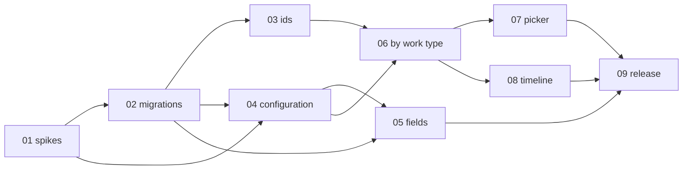

# 11 — Scalable KPI data

Status: **Draft** · Replaces the earlier drafts *11 — KPI native fields*, *13 — KPI ids, not keys* and
*14 — Multi-space KPIs* (and drops *12 — KPI issue context*, which we're not doing). One idea,
implemented in **stages** (the numbered sub-folders), **released together**.

## The idea

Today the app's data model only works for one team-sized KPI space:

| | Today | After this spec |
|---|---|---|
| **What is a KPI** | An issue in **the** KPI project (`kpi:space`) | An issue of the configured **KPI work type**, in **any company-managed space** |
| **KPI identity** | Issue **key** (`KPI-5`). Breaks when a KPI moves | Issue **id** (`10234`). The key is display-only and always fresh from Jira |
| **Unit & direction** | `kpi-meta` entity property. Invisible in Jira, no JQL, no history | **Jira fields**. Shown in the KPI's Details, editable, searchable, in History |
| **Site setup** | Settings creates or connects one project + the `KPI` issue type | Settings builds the **building blocks** (work type, fields, optionally schemes, screens, a central space, hierarchy link) that **any** space can use |
| **Picking a KPI** | One flat list of every KPI | **Suggestions**: your space, then what your parent chain tracks, then search everything you can browse |
| **Panel and Timeline loads** | Load every KPI in the space | Load only what's needed (suggestions, targeted KPIs, the KPIs being shown) |

The problems this solves are written up in each stage: identity
([03](./03-kpi-ids/plan.md)), Jira visibility ([05](./05-kpi-fields/plan.md)), ownership, picker
length and panel speed ([06](./06-kpis-by-work-type/plan.md), [07](./07-kpi-picker/plan.md)).

## Compatibility during the transition

Existing data has to keep working, and **two kinds of old reader** keep reading the old formats until
they're updated:

1. **A customer's reporting app** reads the old data straight from Jira's REST API. It builds a report
   of each work item, the KPIs it targets and the expected change. It reads:
   - the `kpi-meta` property on KPIs (unit, direction);
   - the `kpi-assignments` property on work items, with **`kpiId` as an issue key**;
   - KPIs found with `project = <KPI project>`. It only needs KPIs in that original project.

   That customer will update their app. We keep writing the old formats until they confirm, then ship
   a cleanup release.
2. **Older installs of this app on the same site.** For example, our dev, staging and prod
   environments on `bitovi-training` all point at the same KPI data, and they upgrade at different
   times.

So, until the **cleanup release** ([09](./09-release-and-cleanup/plan.md)):

| Data | New home (read first) | Old format: **still written** | Old format: **still read** |
|---|---|---|---|
| KPI unit & direction | Jira fields (05) | `kpi-meta` property, on every KPI write | Yes. Unmigrated KPIs, and KPIs last written by an older install |
| Target → KPI reference | Issue id (03) | `kpiId` = the KPI's **current key**, on every target write | Yes. Key-only references from unmigrated issues or older installs |
| "Is a KPI" | KPI work type (06) | n/a. The original KPI project stays the central space, so `project = KPI` still finds its KPIs | n/a |
| Site config | New config record (04) | n/a (KVS is per install) | Yes. `kpi:space` and `kpi:hierarchy` seed the new config |

**Rules every stage follows:**

- **Reads accept every shape**: pre-migration, mixed, migrated, and data an **older install wrote
  after** the migration ran. No global "migration done, stop reading the old format" switch is
  allowed while older installs may still write (see [05](./05-kpi-fields/plan.md) *Which value wins*).
- **Writes write both** the new and the old format, in one request where Jira allows it.
- **Migrations only copy.** Deleting old data is the cleanup release's job.
- Every stage ships with fixtures for all data shapes, and its tests run against all of them.

## How it's delivered

- **One long-lived branch**, `feat/11-scalable-data`, with **one PR per stage** into it. `main` and
  production get everything at once when the branch merges.
- Each stage ends with `npm run test:all`, `npm run typecheck` and `npm run lint` passing, and the
  app working end-to-end in the harness. A stage may leave a feature unfinished (for example, a
  backend with no UI yet), but it can't leave one broken.
- The branch is deployed to the **dev** environment for the live checks. Staging stays on `main` so
  that it plays the "older install on the same site" role during testing.
- **Before any stage changes data on the dev site**, capture the legacy reader report
  ([09](./09-release-and-cleanup/plan.md) Step 1). Every live check after that compares against it.

## Stages

| # | Stage | Depends on | Review gate before implementing |
|---|---|---|---|
| 01 | [Jira spikes](./01-jira-spikes/plan.md): check every Jira behaviour the later stages rely on, once, up front | — | Review the findings (G1) |
| 02 | [Migration framework](./02-migration-framework/plan.md): backend runner, records, resolvers. No UI yet | 01 | — |
| 03 | [KPI ids, not keys](./03-kpi-ids/plan.md): ids in DTOs and stored targets, keys kept alongside for old readers, plus a migration | 02 | — |
| 04 | [KPI configuration](./04-kpi-configuration/plan.md): Settings builds the building blocks, plus the **Upgrade data** card | 01, 02 | **Settings prototype (G2)** |
| 05 | [Unit & direction in fields](./05-kpi-fields/plan.md): reads with fallback, dual writes, migration | 02, 04 | — |
| 06 | [KPIs by work type](./06-kpis-by-work-type/plan.md): "is a KPI" by type, KPIs in many spaces, per-space access | 03, 04 | — |
| 07 | [KPI picker](./07-kpi-picker/plan.md): suggestions, search, paste lookup | 06 | **Picker prototype (G3)** |
| 08 | [Timeline & Add KPI across spaces](./08-timeline-across-spaces/plan.md) | 06 | **New prototype, built in this stage (G4)** |
| 09 | [Release & cleanup](./09-release-and-cleanup/plan.md): whole-branch live run, release, upgrade runbook, later cleanup release | all | Review the release checklist (G5) |

03 and 04 can be worked on in parallel, as can 07 and 08.

### Review gates

Prototypes and findings are **reviewed by Justin at the point they're needed, not assumed**. None of
the existing prototypes have settled anything yet. At each gate, the implementer **stops**, asks for
the review, writes the decisions into that stage's spec (answering its questions), and revises its
design and steps **before** writing code.

| Gate | When | What gets reviewed |
|---|---|---|
| G1 | End of 01 | The spike findings, and which open questions they answer |
| G2 | Start of 04 | [kpi-space-setup.html](./04-kpi-configuration/kpi-space-setup.html) (v3; [v1](./04-kpi-configuration/kpi-space-setup-v1.html) and [v2](./04-kpi-configuration/kpi-space-setup-v2.html) are earlier iterations kept for comparison), extended with the upgrade path for existing installs |
| G3 | Start of 07 | [kpi-picker.html](./07-kpi-picker/kpi-picker.html) |
| G4 | Start of 08 | A Timeline / Add KPI prototype, built at the start of 08 |
| G5 | Start of 09 | The release checklist and the message to the customer |

## Shared definitions

These hold in every stage. Where a stage still has an open question about them, the stage says so.

- **KPI work type**: the issue type the site uses for KPIs (`kpiIssueTypeId`). It comes from the
  configuration (04). On an install that hasn't been configured, it's the type named `KPI`, as today.
- **KPI**: an issue whose type is the KPI work type, in a **company-managed** space. Team-managed
  spaces can't hold KPIs: their issue types are private to the space and have their own ids.
- **Central space**: the space Settings creates or connects for company-wide KPIs. On existing
  installs it's the current `kpi:space` project. Whether it's optional is a G2 question.
- **KPI id / key**: the id is identity. The key is for labels and `/browse/{key}` links, and is never
  trusted from stored data.
- **Old reader**: anything that reads the pre-spec formats (see *Compatibility*).

## Cohesion checklist

Before closing each stage's PR, check that it still agrees with the rest:

1. **One definition of "is a KPI"**: the KPI work type, everywhere (backend checks, searches,
   migrations).
2. **Field ids come from the configuration**, never from names, in every read, write and migration.
3. **Settings configures the building blocks and the central space only.** Other spaces are set up by
   their admins (guided by 04). Reads and writes never assume a field is on a space's screens.
4. **Permissions are per project**: spec 10's single-space `KpiSpaceAccess` becomes access to *the
   KPI's own project*.
5. **Migrations** count what's left **as the app**, so KPIs hidden from the admin running them still
   count toward "done".
6. **Old readers** still get every old-format write listed in *Compatibility*.

## Out of scope

- The KPI sidebar (`jira:issueContext`, former spec 12). Dropped.
- Compatibility with CascadeMCP writing old formats.
- Team-managed spaces holding KPIs.
- Moving KPIs between spaces from inside the app (Jira's own Move works once 03 lands).
- Enabling KPIs in other spaces *from the app*. Space admins and Jira admins do it in Jira, guided by
  Settings (04).

## Questions

1. **Customer coordination.** Should we send the customer the new formats early (target references
   carry an id next to the key; unit and direction live in fields; KPIs can live outside the KPI
   project), so they can update their app while we build? And should we ask them to confirm their app
   ignores unknown keys? Stage 03 adds `kpiIssueId` / `kpiIssueIds` to `kpi-assignments`, and stage 05
   adds a `fields: true` marker to `kpi-meta`.
2. **Cleanup trigger.** Is "the customer confirms their app reads the new format, and every
   environment on our sites is upgraded" the right trigger for the cleanup release, or should there
   also be a fixed date?
3. **Staging during development.** OK to keep staging on `main` (as the "older install" for
   compatibility tests) until the branch merges?
