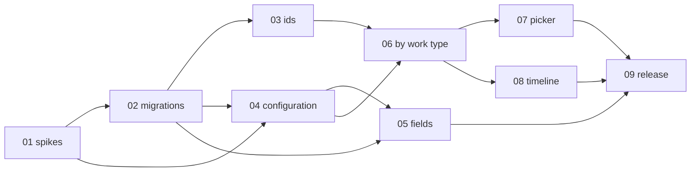

# 11 — Scalable KPI data

Status: **Draft** · Replaces the earlier drafts *11 — KPI native fields*, *13 — KPI ids, not keys* and
*14 — Multi-space KPIs* (and drops *12 — KPI issue context*, which we're not doing). One idea,
implemented in **stages** (the numbered sub-folders), **released together**.

## The idea

Today the app's data model only works for one team-sized KPI space:

| | Today | After this spec |
|---|---|---|
| **What is a KPI** | An issue in **the** KPI project (`kpi:space`) | An issue of the configured **KPI work type**, in **any company-managed space** |
| **KPI identity** | Issue **key** (`KPI-5`). Breaks when a KPI moves | Issue **id** (`10234`). The key is display-only and always fresh from Jira |
| **Unit & direction** | `kpi-meta` entity property. Invisible in Jira, no JQL, no history | **Jira fields**. Shown in the KPI's Details, editable, searchable, in History |
| **Site setup** | Settings creates or connects one project + the `KPI` issue type | Settings builds the **building blocks** (work type, fields, optionally schemes, screens, a central space, hierarchy link) that **any** space can use |
| **Picking a KPI** | One flat list of every KPI | A **two-pane KPI browser** that opens from the KPI field: what the work item's **parents** target (with their targets), **this space**, the **parents' spaces** and **Global KPIs**, then **All KPIs** with search and a space filter. Paste a key from anywhere ([07](./07-kpi-picker/plan.md)) |
| **Panel and Timeline loads** | Load every KPI in the space, and every KPI's readings | **No surface loads every KPI's readings**: readings are fetched only for KPIs that are shown or targeted. How much of the catalog is *listed* is a UI decision per surface: the picker loads only the views tied to the work item and fetches the rest when opened (07); the Timeline's scope is 08's question |

The problems this solves are written up in each stage: identity
([03](./03-kpi-ids/plan.md)), Jira visibility ([05](./05-kpi-fields/plan.md)), ownership, picker
length and panel speed ([06](./06-kpis-by-work-type/plan.md), [07](./07-kpi-picker/plan.md)).

## Compatibility during the transition

**One kind of old reader is supported: a customer's reporting app.** It reads the old data straight
from Jira's REST API and builds a report of each work item, the KPIs it targets and the expected
change. It reads:

- the `kpi-meta` property on KPIs (unit, direction);
- the `kpi-assignments` property on work items, with **`kpiId` as an issue key** (found with
  `kpiIds IS NOT EMPTY`);
- KPIs found with `project = <KPI project>`. It only needs KPIs in that original project.

That customer will update their app. We keep **writing** the old formats until they confirm, then
ship a cleanup release.

**This app itself doesn't read the old formats.** Every install is upgraded and a Jira admin runs the
migrations (Settings → **Upgrade data**) right after deploying. Until they do, the app may show
incomplete data (targets missing, units and directions empty once fields are chosen). That's accepted,
and nothing special is shown. **Older installs of this app** (e.g. staging still on `main`) aren't
supported once the data is migrated: anything they write in the old format afterwards isn't picked
up, and nothing detects it.

So, until the **cleanup release** ([09](./09-release-and-cleanup/plan.md)):

| Data | New home (this app reads only this) | Old format: **still written**, for the customer's app |
|---|---|---|
| KPI unit & direction | Jira fields (05). Before fields are chosen in Settings (`fields: null`), `kpi-meta` is still the only source | `kpi-meta` property, on every KPI write, and on edits made in Jira's own field UI (05's sync trigger) |
| Target → KPI reference | Issue id (03), found with `kpiIssueIds IS NOT EMPTY` | `kpiId` = the KPI's **current key**, and the `kpiIds` index array, on every target write |
| "Is a KPI" | KPI work type (06) | n/a. The original KPI project stays the central space, so `project = KPI` still finds its KPIs |
| Site config | New config record (04), seeded from `kpi:space` and `kpi:hierarchy` on first read | n/a (KVS is per install, and the customer's app doesn't read it) |

**Rules every stage follows:**

- **Reads use the new format only.** No fallback to keys or `kpi-meta` (except `fields: null`, above).
- **Writes write both** the new and the old format, in one request where Jira allows it.
- **Migrations only copy.** Deleting old data is the cleanup release's job.
- Every stage's fixtures include **pre-migration** and **migrated** data: tests check the migrated
  shape reads correctly and that every write still produces what the customer's app reads.

## How it's delivered

- **One long-lived branch**, `feat/11-scalable-data`, with **one PR per stage** into it. `main` and
  production get everything at once when the branch merges.
- Each stage ends with `npm run test:all`, `npm run typecheck` and `npm run lint` passing, and the
  app working end-to-end in the harness. A stage may leave a feature unfinished (for example, a
  backend with no UI yet), but it can't leave one broken.
- The branch is deployed to the **dev** environment for the live checks. Staging stays on `main` until
  the branch merges; once dev has migrated the shared data, staging isn't expected to show it
  correctly (older installs aren't supported, see *Compatibility*).
- **Before any stage changes data on the dev site**, capture the legacy reader report
  ([09](./09-release-and-cleanup/plan.md) Step 1). Every live check after that compares against it.

## Stages

| # | Stage | Depends on | Review gate before implementing |
|---|---|---|---|
| 01 | [Jira spikes](./01-jira-spikes/plan.md): check every Jira behaviour the later stages rely on, once, up front | — | Review the findings (G1) |
| 02 | [Migration framework](./02-migration-framework/plan.md): backend runner, records, resolvers. No UI yet | 01 | — |
| 03 | [KPI ids, not keys](./03-kpi-ids/plan.md): ids in DTOs and stored targets, keys kept alongside for old readers, plus a migration | 02 | — |
| 04 | [KPI configuration](./04-kpi-configuration/plan.md): Settings builds the building blocks, plus the **Upgrade data** card | 01, 02 | **Settings prototype (G2)** |
| 05 | [Unit & direction in fields](./05-kpi-fields/plan.md): reads from fields, dual writes, migration | 02, 04 | — |
| 06 | [KPIs by work type](./06-kpis-by-work-type/plan.md): "is a KPI" by type, KPIs in many spaces, per-space access | 03, 04 | — |
| 07 | [KPI picker](./07-kpi-picker/plan.md): the two-pane KPI browser, search, paste lookup | 06 | **Picker prototype (G3)**: reviewed 2026-11-20 |
| 08 | [Timeline & Add KPI across spaces](./08-timeline-across-spaces/plan.md): a tree-first Timeline, a KPI space filter, rows that expand to their timeline, Add KPI in a chosen space | 06 | **Timeline prototype (G4)** |
| 09 | [Release & cleanup](./09-release-and-cleanup/plan.md): whole-branch live run, release, upgrade runbook, later cleanup release | all | Review the release checklist (G5) |

03 and 04 can be worked on in parallel, as can 07 and 08.

### Review gates

Prototypes and findings are **reviewed by Justin at the point they're needed, not assumed**. At each
gate, the implementer **stops**, asks for the review, writes the decisions into that stage's spec
(answering its questions), and revises its design and steps **before** writing code. G3 (the picker) has
been reviewed (2026-11-20); its decisions are in [07](./07-kpi-picker/plan.md). The other prototypes
haven't settled anything yet.

| Gate | When | What gets reviewed |
|---|---|---|
| G1 | End of 01 | The spike findings, and which open questions they answer |
| G2 | Start of 04 | [kpi-space-setup.html](./04-kpi-configuration/kpi-space-setup.html) (v3; [v1](./04-kpi-configuration/kpi-space-setup-v1.html) and [v2](./04-kpi-configuration/kpi-space-setup-v2.html) are earlier iterations kept for comparison), extended with the upgrade path for existing installs |
| G3 | Start of 07 | [kpi-picker.html](./07-kpi-picker/kpi-picker.html): **done 2026-11-20** (two-pane browser chosen; remaining questions in 07) |
| G4 | Start of 08 | A Timeline / Add KPI prototype, built at the start of 08 |
| G5 | Start of 09 | The release checklist and the message to the customer |

## Shared definitions

These hold in every stage. Where a stage still has an open question about them, the stage says so.

- **KPI work type**: the issue type the site uses for KPIs (`kpiIssueTypeId`). It comes from the
  configuration (04). On an install that hasn't been configured, it's the type named `KPI`, as today.
- **KPI**: an issue whose type is the KPI work type, in a **company-managed** space. Team-managed
  spaces can't hold KPIs: their issue types are private to the space and have their own ids.
- **Central space**: the space Settings creates or connects for company-wide KPIs. On existing
  installs it's the current `kpi:space` project. Whether it's optional is a G2 question. The KPI picker
  (07) shows it as **"Global KPIs"**.
- **KPI id / key**: the id is identity. The key is for labels and `/browse/{key}` links, and is never
  trusted from stored data.
- **KPI hierarchy**: a **tree**. Each KPI has **at most one parent KPI** (decided 2026-11-21; see 06),
  which may be in another space. Not to be confused with a work item's parents (Story → Epic →
  Initiative), which 07 walks.
- **Old reader**: the customer's reporting app, which reads the pre-spec formats (see *Compatibility*).
  Older installs of this app are not old readers we support.

## Sites this affects

- **bitovi-training**: our test site, with the dev and staging installs. It has a **single** KPI project.
- **One customer site**, which we manage. It's the only production site with KPI data to upgrade.

There's no wider install base, so site-specific risks are handled by **one-time checks on these two
sites** rather than by design. For example: confirm the KPI project's work type scheme isn't shared
with other projects (or that `issuetype = KPI AND project != KPI` is empty), so that "a KPI is an issue
of the KPI work type" (06) doesn't suddenly pick up issues elsewhere (01 B1, 09 checklist).

## Review notes (2026-11-20)

A cross-stage review of these specs found the items below. **Resolved** ones have been written into the
stages; **open** ones still need a decision or a spec change in the stage named. Check each off (or
move it into its stage) before that stage starts.

| # | Finding | Status / where |
|---|---|---|
| R1 | Existing sites might already offer the KPI type in many projects (a shared work type scheme) | **Resolved**: only two sites; a one-time check (*Sites this affects*, 01 B1, 09) |
| R2 | 03's `refsVersion: 2` is only carried over, so a work item that gets its **first** target after the release is never stamped and counts as pending forever (blocking 09's cleanup). Fix: also stamp when the stored property had no key-only references before the write | **Open**: 03 |
| R3 | Timeline discovery searches `kpiIssueIds IS NOT EMPTY`: every targeted work item on the site, unbounded. Search `kpiIssueIds in (…the KPIs being shown)` instead (01 should check `in` with many values on a string index) | **Open**: 03 / 08 |
| R4 | `fetchReadingChangelog` ([jira.ts](../../app/src/backend/jira.ts)) sends one bulk changelog request capped at 1,000 issues and 1,000 histories, with no paging: past that, readings are silently cut off. The Timeline needs paging | **Open**: 08 |
| R5 | Recording a value needs the **KPI Reading** field in the space's field configuration (the 04 v3 prototype's guide says so), but no spike checks it; 01 B5 only covers fields that aren't on screens. Also, KPI Reading is a Forge-owned field, so **each install (dev, staging, prod) has its own**: a shared field scheme would need all of them | **Open**: 01 B5, 04 Q1/Q9 |
| R6 | 06 depends on 05 (it reads 05's fields and checks the marked `kpi-meta`), but the stage graph doesn't show it; and 05 Step 5 tests "KPIs in two projects" before 06 builds the multi-space fixture | **Open**: this file's graph, 05 |
| R7 | 03 and 04 aren't fully parallel: 04 Step 7 runs 03's migration from the card | **Open**: this file |
| R8 | 03's write path: the `id in (…)` lookup that refreshes the stored keys must run **as the app** (Step 3 expects it to cover KPIs the user can't see); and it doesn't say what happens to an id reference whose KPI was deleted | **Open**: 03 |
| R9 | 08 says the Space filter is built "from the loaded KPIs (no extra request)", but if 08 Q1 scopes the Timeline's load, that list doesn't exist without a request | **Open**: 08 |
| R10 | The customer's report (`project = KPI`) won't see KPIs created outside the central space, or targets pointing at them | **Open**: the customer message (Q1, 09 G5) |
| R11 | 05's "Today" column is out of date: `updateKpiDefinition` already sends summary + `kpi-meta` in one `PUT` (01 A6 half answered); KPI Reading already shows A1's one-field-per-environment behaviour | **Open**: 05, 01 |
| R12 | 05's sync trigger (`avi:jira:updated:issue`) fires for every issue on the site; it should use the manifest filter to the KPI work type | **Open**: 05 |
| R13 | The overview's "load only what's needed" goal depended on UI decisions; reworded (*The idea*, "Panel and Timeline loads") | **Resolved** |
| R14 | Can a KPI have several parent KPIs? Links allow it, and the code took whichever link came first | **Resolved (2026-11-21)**: one parent, a tree (*Shared definitions*, 06) |
| R15 | The Timeline is a global page with no "current space". Portfolio / product / team spaces each need to see their own KPIs in context | **Resolved (2026-11-21)**: 08 focuses on the one tree page with a KPI space filter and Add KPI in a chosen space; per-space pages (`jira:projectPage`, spike 01 F1) come later as a preset of it |
| R16 | `fetchKpiSpaceIssues` stops after 50 pages (5,000 KPIs) without an error, despite its "fail loudly" comment. Matters once the search spans every space | **Open**: 06 / 08 |

## Cohesion checklist

Before closing each stage's PR, check that it still agrees with the rest:

1. **One definition of "is a KPI"**: the KPI work type, everywhere (backend checks, searches,
   migrations).
2. **Field ids come from the configuration**, never from names, in every read, write and migration.
3. **Settings configures the building blocks and the central space only.** Other spaces are set up by
   their admins (guided by 04). Reads and writes never assume a field is on a space's screens.
4. **Permissions are per project**: spec 10's single-space `KpiSpaceAccess` becomes access to *the
   KPI's own project*.
5. **Migrations** count what's left **as the app**, so KPIs hidden from the admin running them still
   count toward "done".
6. **Old readers** still get every old-format write listed in *Compatibility*.

## Out of scope

- The KPI sidebar (`jira:issueContext`, former spec 12). Dropped.
- Compatibility with CascadeMCP writing old formats.
- Team-managed spaces holding KPIs.
- Moving KPIs between spaces from inside the app (Jira's own Move works once 03 lands).
- Enabling KPIs in other spaces *from the app*. Space admins and Jira admins do it in Jira, guided by
  Settings (04).

## Questions

1. **Customer coordination.** Should we send the customer the new formats early (target references
   carry an id next to the key; unit and direction live in fields; KPIs can live outside the KPI
   project), so they can update their app while we build? And should we ask them to confirm their app
   ignores unknown keys? Stage 03 adds `kpiIssueId` / `kpiIssueIds` to `kpi-assignments`, and stage 05
   adds a `fields: true` marker to `kpi-meta`.
2. **Cleanup trigger.** Is "the customer confirms their app reads the new format, and every
   environment on our sites is upgraded" the right trigger for the cleanup release, or should there
   also be a fixed date?
3. **Staging during development.** OK to keep staging on `main` until the branch merges, knowing it
   won't show dev's migrated data correctly (older installs aren't supported)?
