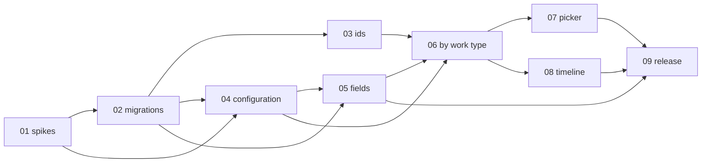

# 11 — Scalable KPI data

Status: **Draft** · Replaces the earlier drafts *11 — KPI native fields*, *13 — KPI ids, not keys* and
*14 — Multi-space KPIs* (and drops *12 — KPI issue context*, which we're not doing). One idea,
implemented in **stages** (the numbered sub-folders), **released together**.

## The idea

Today the app's data model only works for one team-sized KPI space:

| | Today | After this spec |
|---|---|---|
| **What is a KPI** | An issue in **the** KPI project (`kpi:space`) | An issue of the configured **KPI work type**, in **any company-managed space** |
| **KPI identity** | Issue **key** (`KPI-5`). Breaks when a KPI moves | Issue **id** (`10234`). The key is display-only and always fresh from Jira |
| **Unit & direction** | `kpi-meta` entity property. Invisible in Jira, no JQL, no history | **Jira fields**. Shown in the KPI's Details, editable, searchable, in History |
| **Site setup** | Settings creates or connects one project + the `KPI` issue type | Settings builds the **building blocks** (work type, fields, optionally schemes, screens, a central space, hierarchy link) that **any** space can use |
| **Picking a KPI** | One flat list of every KPI | A **two-pane KPI browser** that opens from the KPI field: what the work item's **parents** target (with their targets), **this space**, the **parents' spaces** and **Global KPIs**, then **All KPIs** with search and a space filter. Paste a key from anywhere ([07](./07-kpi-picker/plan.md)) |
| **Panel and Timeline loads** | Load every KPI in the space, and every KPI's readings | **The issue panel never loads every KPI's readings**: the picker loads only the views tied to the work item and fetches the rest when opened (07), and a KPI's own panel loads only that KPI (06, Q4). **The central KPI Timeline still shows every KPI** the user can browse, with readings paged past today's caps (08, Q5). Space pages and paging that page come later |

The problems this solves are written up in each stage: identity
([03](./03-kpi-ids/plan.md)), Jira visibility ([05](./05-kpi-fields/plan.md)), ownership, picker
length and panel speed ([06](./06-kpis-by-work-type/plan.md), [07](./07-kpi-picker/plan.md)).

## Compatibility during the transition

**One kind of old reader is supported: a customer's reporting app.** It reads the old data straight
from Jira's REST API and builds a report of each work item, the KPIs it targets and the expected
change. It reads:

- the `kpi-meta` property on KPIs (unit, direction);
- the `kpi-assignments` property on work items, with **`kpiId` as an issue key** (found with
  `kpiIds IS NOT EMPTY`);
- KPIs found with `project = <KPI project>`. It only needs KPIs in that original project.

That customer will update their app. We keep **writing** the old formats until they confirm, then
ship a cleanup release.

**This app itself doesn't read the old formats.** Every install is upgraded and a Jira admin runs the
migrations (Settings → **Upgrade data**) right after deploying. Until they do, the app may show
incomplete data (targets missing, units and directions empty once fields are chosen). That's accepted,
and nothing special is shown. **Older installs of this app** (e.g. staging still on `main`) aren't
supported once the data is migrated: anything they write in the old format afterwards isn't picked
up, and nothing detects it.

So, until the **cleanup release** ([09](./09-release-and-cleanup/plan.md)):

| Data | New home (this app reads only this) | Old format: **still written**, for the customer's app |
|---|---|---|
| KPI unit & direction | Jira fields (05). Before fields are chosen in Settings (`fields: null`), `kpi-meta` is still the only source | `kpi-meta` property, on every KPI write, and on edits made in Jira's own field UI (05's sync trigger) |
| Target → KPI reference | Issue id (03), found with `kpiIssueIds IS NOT EMPTY` | `kpiId` = the KPI's **current key**, and the `kpiIds` index array, on every target write |
| "Is a KPI" | KPI work type (06) | n/a. The original KPI project stays the central space, so `project = KPI` still finds its KPIs |
| Site config | New config record (04), seeded from `kpi:space` and `kpi:hierarchy` on first read | n/a (KVS is per install, and the customer's app doesn't read it) |

**Rules every stage follows:**

- **Reads use the new format only.** No fallback to keys or `kpi-meta` (except `fields: null`, above).
- **Writes write both** the new and the old format, in one request where Jira allows it.
- **Migrations only copy.** Deleting old data is the cleanup release's job.
- Every stage's fixtures include **pre-migration** and **migrated** data: tests check the migrated
  shape reads correctly and that every write still produces what the customer's app reads.

## How it's delivered

- **One long-lived branch**, `feat/11-scalable-data`, with **one PR per stage** into it. `main` and
  production get everything at once when the branch merges.
- Each stage ends with `npm run test:all`, `npm run typecheck` and `npm run lint` passing, and the
  app working end-to-end in the harness. A stage may leave a feature unfinished (for example, a
  backend with no UI yet), but it can't leave one broken.
- The branch is deployed to the **dev** environment for the live checks. Staging stays on `main` until
  the branch merges; once dev has migrated the shared data, staging isn't expected to show it
  correctly (older installs aren't supported, see *Compatibility*).
- **Before any stage changes data on the dev site**, capture the legacy reader report
  ([09](./09-release-and-cleanup/plan.md) Step 1). Every live check after that compares against it.

## Stages

| # | Stage | Depends on | Review gate before implementing |
|---|---|---|---|
| 01 | [Jira spikes](./01-jira-spikes/plan.md): check every Jira behaviour the later stages rely on, once, up front | — | Review the findings (G1) |
| 02 | [Migration framework](./02-migration-framework/plan.md): backend runner, records, resolvers. No UI yet | 01 | — |
| 03 | [KPI ids, not keys](./03-kpi-ids/plan.md): ids in DTOs and stored targets, keys kept alongside for old readers, plus a migration | 02 | — |
| 04 | [KPI configuration](./04-kpi-configuration/plan.md): Settings builds the building blocks, plus the **Upgrade data** card | 01, 02 | **Settings prototype (G2)** |
| 05 | [Unit & direction in fields](./05-kpi-fields/plan.md): reads from fields, dual writes, migration | 02, 04 | — |
| 06 | [KPIs by work type](./06-kpis-by-work-type/plan.md): "is a KPI" by type, KPIs in many spaces, per-space access (looked up lazily), a KPI's own panel loading only that KPI, wording for many spaces | 03, 04, 05 | — |
| 07 | [KPI picker](./07-kpi-picker/plan.md): the two-pane KPI browser, search, paste lookup | 06 | **Picker prototype (G3)**: reviewed 2026-11-20 |
| 08 | [Timeline & Add KPI across spaces](./08-timeline-across-spaces/plan.md): today's Timeline rows (every KPI) scoped by a KPI space filter with compact ancestor rows, Plans-style row actions, Add KPI in a chosen space | 06 | **Timeline prototype (G4)** |
| 09 | [Release & cleanup](./09-release-and-cleanup/plan.md): whole-branch live run, release, upgrade runbook, later cleanup release | all | Review the release checklist (G5) |

03 and 04 can be worked on in parallel, except 04 Step 7's live check, which runs 03's migration from the card (R7). 07 and 08 can be worked on in parallel.

### Implementation status (2026-11-25)

**Picking this up? Start with [status.md](./status.md).**

Implemented on `feat/11-scalable-data` (local, not pushed) and checked live on dev, as Justin, a Jira
admin. **Every stage through 08 is done; 09 stopped at gate G5.** Justin asked the implementer to keep
going without stopping at the gates, so **G1, G2 and G4 were decided by the implementer** and are
recorded as such in 01, 04 and 08, ready for his review. Checks that need a non-admin user were deferred
by Justin and are listed in 09 (*Progress*).

### Review gates

Prototypes and findings are **reviewed by Justin at the point they're needed, not assumed**. At each
gate, the implementer **stops**, asks for the review, writes the decisions into that stage's spec
(answering its questions), and revises its design and steps **before** writing code. G3 (the picker) has
been reviewed (2026-11-20); its decisions are in [07](./07-kpi-picker/plan.md). The other prototypes
haven't settled anything yet.

| Gate | When | What gets reviewed |
|---|---|---|
| G1 | End of 01 | The spike findings, and which open questions they answer |
| G2 | Start of 04 | [kpi-space-setup.html](./04-kpi-configuration/kpi-space-setup.html) (v3; [v1](./04-kpi-configuration/kpi-space-setup-v1.html) and [v2](./04-kpi-configuration/kpi-space-setup-v2.html) are earlier iterations kept for comparison), extended with the upgrade path for existing installs |
| G3 | Start of 07 | [kpi-picker.html](./07-kpi-picker/kpi-picker.html): **done 2026-11-20** (two-pane browser chosen; remaining questions in 07) |
| G4 | Start of 08 | [timeline-scope.html](./08-timeline-across-spaces/timeline-scope.html) (supersedes [timeline-spaces.html](./08-timeline-across-spaces/timeline-spaces.html)), plus the lazy permission states (08 Step 1) |
| G5 | Start of 09 | The release checklist and the message to the customer |

## Shared definitions

These hold in every stage. Where a stage still has an open question about them, the stage says so.

- **KPI work type**: the issue type the site uses for KPIs (`kpiIssueTypeId`). It comes from the
  configuration (04). On an install that hasn't been configured, it's the type named `KPI`, as today.
- **KPI**: an issue whose type is the KPI work type, in a **company-managed** space. Team-managed
  spaces can't hold KPIs: their issue types are private to the space and have their own ids.
- **Central space**: the space Settings creates or connects for company-wide KPIs. On existing
  installs it's the current `kpi:space` project. Whether it's optional is a G2 question. The KPI picker
  (07) shows it as **"Global KPIs"**.
- **KPI id / key**: the id is identity. The key is for labels and `/browse/{key}` links, and is never
  trusted from stored data.
- **KPI hierarchy**: a **tree**. Each KPI has **at most one parent KPI** (decided 2026-11-21; see 06),
  which may be in another space. Not to be confused with a work item's parents (Story → Epic →
  Initiative), which 07 walks.
- **Old reader**: the customer's reporting app, which reads the pre-spec formats (see *Compatibility*).
  Older installs of this app are not old readers we support.

## Sites this affects

- **bitovi-training**: our test site, with the dev and staging installs. It has a **single** KPI project.
- **One customer site**, which we manage. It's the only production site with KPI data to upgrade.

There's no wider install base, so site-specific risks are handled by **one-time checks on these two
sites** rather than by design. For example: confirm the KPI project's work type scheme isn't shared
with other projects (or that `issuetype = KPI AND project != KPI` is empty), so that "a KPI is an issue
of the KPI work type" (06) doesn't suddenly pick up issues elsewhere (01 B1, 09 checklist).

## Review notes (2026-11-20)

A cross-stage review of these specs found the items below. **Resolved** ones have been written into the
stages; **open** ones still need a decision or a spec change in the stage named. Check each off (or
move it into its stage) before that stage starts.

| # | Finding | Status / where |
|---|---|---|
| R1 | Existing sites might already offer the KPI type in many projects (a shared work type scheme) | **Resolved**: only two sites; a one-time check (*Sites this affects*, 01 B1, 09) |
| R2 | 03's `refsVersion: 2` is only carried over, so a work item that gets its **first** target after the release is never stamped and counts as pending forever (blocking 09's cleanup). Fix: also stamp when the stored property had no key-only references before the write | **Resolved (2026-11-24)**: 03 stamps an issue whose stored property had no key-only references (*Stored format*) |
| R3 | Timeline discovery searches `kpiIssueIds IS NOT EMPTY`: every targeted work item on the site, unbounded. Search `kpiIssueIds in (…the KPIs being shown)` instead (01 should check `in` with many values on a string index) | **Deferred (2026-11-24)**: the central page shows every KPI (Q5), so narrowing helps only on later space pages. Still used by the KPI View (Q4) |
| R4 | `fetchReadingChangelog` ([jira.ts](../../app/src/backend/jira.ts)) sends one bulk changelog request capped at 1,000 issues and 1,000 histories, with no paging: past that, readings are silently cut off. The Timeline needs paging | **Resolved (2026-11-25)**: 08 Step 3 (`fetchReadingChangelog` batches 1,000 issues and pages by `nextPageToken`) |
| R5 | Recording a value needs the **KPI Reading** field in the space's field configuration (the 04 v3 prototype's guide says so), but no spike checks it; 01 B5 only covers fields that aren't on screens. Also, KPI Reading is a Forge-owned field, so **each install (dev, staging, prod) has its own**: a shared field scheme would need all of them | **Spike added (2026-11-24)**: 01 B8. Still open: 04 Q1/Q9 |
| R6 | 06 depends on 05 (it reads 05's fields and checks the marked `kpi-meta`), but the stage graph doesn't show it; and 05 Step 5 tests "KPIs in two projects" before 06 builds the multi-space fixture | **Resolved (2026-11-24)**: 06 depends on 05 (table, graph); the two-project migration check moved to 06 Step 4 |
| R7 | 03 and 04 aren't fully parallel: 04 Step 7 runs 03's migration from the card | **Resolved (2026-11-24)**: noted under the graph and in 04 (Depends on, Step 7) |
| R8 | 03's write path: the `id in (…)` lookup that refreshes the stored keys must run **as the app** (Step 3 expects it to cover KPIs the user can't see); and it doesn't say what happens to an id reference whose KPI was deleted | **Resolved (2026-11-24)**: 03 *Writes*: the lookup runs as the app; a deleted KPI's id keeps its stored key |
| R9 | 08 says the Space filter is built "from the loaded KPIs (no extra request)", but if 08 Q1 scopes the Timeline's load, that list doesn't exist without a request | **Resolved (2026-11-24)**: the page loads every KPI (Q5) |
| R10 | The customer's report (`project = KPI`) won't see KPIs created outside the central space, or targets pointing at them | **Open**: the customer message (Q1, 09 G5) |
| R11 | 05's "Today" column is out of date: `updateKpiDefinition` already sends summary + `kpi-meta` in one `PUT` (01 A6 half answered); KPI Reading already shows A1's one-field-per-environment behaviour | **Resolved (2026-11-24)**: 05 *Writes* table, 01 A1/A6 |
| R12 | 05's sync trigger (`avi:jira:updated:issue`) fires for every issue on the site; it should use the manifest filter to the KPI work type | **Resolved (2026-11-24)**: 05 trigger uses `filter.expression` on the `kpi-meta` marker (01 A9 checks it) |
| R13 | The overview's "load only what's needed" goal depended on UI decisions; reworded (*The idea*, "Panel and Timeline loads") | **Resolved** |
| R14 | Can a KPI have several parent KPIs? Links allow it, and the code took whichever link came first | **Resolved (2026-11-21)**: one parent, a tree (*Shared definitions*, 06) |
| R15 | The Timeline is a global page with no "current space". Portfolio / product / team spaces each need to see their own KPIs in context | **Resolved (2026-11-21)**: 08 focuses on the one tree page with a KPI space filter and Add KPI in a chosen space; per-space pages (`jira:projectPage`, spike 01 F1) come later as a preset of it |
| R16 | `fetchKpiSpaceIssues` stops after 50 pages (5,000 KPIs) without an error, despite its "fail loudly" comment. Matters once the search spans every space | **Deferred (2026-11-24)**: Q6; paging the KPI tree page comes later |
| R17 | *(2026-11-24)* This file's stage table and G4 row still describe 08 as "a tree-first Timeline … rows that expand to their timeline", with a prototype "built at the start of 08". 08 has since chosen [timeline-scope.html](./08-timeline-across-spaces/timeline-scope.html) (today's rows plus a KPI space scope), and the prototype already exists | **Resolved (2026-11-24)**: stage table and G4 row |
| R18 | 08 still carries text from the superseded [timeline-spaces.html](./08-timeline-across-spaces/timeline-spaces.html): a "timeline toggle … in its own column", "show timeline, record a value" in More actions, Step 1's "expanding a row" scenario, and Parent options showing `{key}`. timeline-scope.html draws the track inline, its menu is *Edit / Move under another KPI / Open in Jira*, and Parent shows the name only | **Resolved (2026-11-24)**: 08 *Direction* and Step 1; Parent keeps its key (Q7), now in the prototype too |
| R19 | 08 Q1 (compact or full ancestor rows) is still open, but *Direction* already says compact rows are "decided" | **Resolved (2026-11-24)**: compact; 08 Q1 |
| R20 | 06 contradicts itself: the Design table says `createKpi` "takes a **required** `projectId`", but Step 4 says "`createKpi` with **optional** `projectId`" | **Resolved (2026-11-24)**: required, 06 Step 4 |
| R21 | 08 Step 3 checks that "the central space comes first" in `getKpiCreateSpaces`, while *Direction* says Add KPI never defaults to it. If that's only list order, say so | **Resolved (2026-11-24)**: 08 Step 3 checks nothing is preselected unless there's one space |
| R22 | R9 is answered by 08's decision (the page loads every KPI, so the Space filter needs no request). That conflicted with *The idea*'s "no surface loads every KPI's readings" when the scope is all KPIs (Q5) | **Resolved (2026-11-24)**: Q5 (a); *The idea* reworded |
| R23 | `fetchTargetContributions` has R16's silent 50-page cap too (5,000 targeted work items), and it stops on a failed page (`if (!res.ok) break`), so missing targets look like no targets | **Deferred (2026-11-24)**: Q6 |
| R24 | 01 has no row for two checks the notes above ask of it: `kpiIssueIds in (…)` with many values and the JQL length limit (R3), and KPI Reading in a space's field configuration (R5) | **Resolved (2026-11-24)**: 01 B8 added; a C5 isn't needed while R3 is deferred |
| R25 | 05's sync trigger fires for the app's **own** field writes too (KPI edits, and once per KPI during `kpi-meta-to-fields`). A9 only checks property writes. The handler should skip when `kpi-meta` already matches the fields | **Resolved (2026-11-24)**: 05 trigger `filter.ignoreSelf` + a no-op check (01 A9 checks it) |
| R26 | 08 says "search still matches keys", but `summary ~ "text*"` (07's search) never matches a key. Add `OR key = …` when the text looks like a key (07's paste covers full keys pasted as keys, not typed ones) | **Resolved (2026-11-24)**: 07 runs `lookupKpiRef` next to the search for a whole key; 08's Parent search too |
| R27 | 07 says a pasted old key of a moved KPI is "resolved (03)", but 03's `resolveKpiKeys` is migration-only. The paste lookup is its own `GET /issue/{key}` as the user (Jira follows moved keys) | **Resolved (2026-11-24)**: 07 *Search and paste* |

## Cohesion checklist

Before closing each stage's PR, check that it still agrees with the rest:

1. **One definition of "is a KPI"**: the KPI work type, everywhere (backend checks, searches,
   migrations).
2. **Field ids come from the configuration**, never from names, in every read, write and migration.
3. **Settings configures the building blocks and the central space only.** Other spaces are set up by
   their admins (guided by 04). Reads and writes never assume a field is on a space's screens.
4. **Permissions are per project, looked up when needed**: spec 10's single-space `KpiSpaceAccess`
   becomes access to *the KPI's own project*, fetched when an action is used and cached per space,
   never on load (06, Q10).
5. **Migrations** count what's left **as the app**, so KPIs hidden from the admin running them still
   count toward "done".
6. **Old readers** still get every old-format write listed in *Compatibility*.

## Out of scope

- The KPI sidebar (`jira:issueContext`, former spec 12). Dropped.
- Compatibility with CascadeMCP writing old formats.
- Team-managed spaces holding KPIs.
- Moving KPIs between spaces from inside the app (Jira's own Move works once 03 lands).
- Enabling KPIs in other spaces *from the app*. Space admins and Jira admins do it in Jira, guided by
  Settings (04).

## Questions

1. **Customer coordination.** Should we send the customer the new formats early (target references
   carry an id next to the key; unit and direction live in fields; KPIs can live outside the KPI
   project), so they can update their app while we build? And should we ask them to confirm their app
   ignores unknown keys? Stage 03 adds `kpiIssueId` / `kpiIssueIds` to `kpi-assignments`, and stage 05
   adds a `fields: true` marker to `kpi-meta`.
2. **Cleanup trigger.** Is "the customer confirms their app reads the new format, and every
   environment on our sites is upgraded" the right trigger for the cleanup release, or should there
   also be a fixed date?
3. **Staging during development.** OK to keep staging on `main` until the branch merges, knowing it
   won't show dev's migrated data correctly (older installs aren't supported)?
   - **Answered (2026-11-24): yes**, keep staging on `main` (the easier option). 01 A1 is skipped, so
     nothing needs a branch build on staging.

_Added by the 2026-11-24 review (see R17–R27 for wording fixes that need no decision)._

4. **The KPI's own issue panel (KPI View) isn't covered by any stage.** When the panel opens on a KPI,
   `buildPanelList` calls `buildTimelineParts()` ([resolver.ts](../../app/src/backend/resolver.ts)): every
   KPI, every reading and every target on the site, just to find one node. After 06 that means the whole
   site's KPIs each time someone opens a KPI. Which stage owns this (06 or 08), and what should it load?
   Suggested default: the KPI, its sub-KPIs and ancestors, readings for those KPIs only, and targets via
   `kpiIssueIds in (…those ids)`.
   - **Why it loads everything today (2026-11-24):** spec 04 (KPI View) reused the Timeline's
     `TimelineNodeDto` so the panel draws exactly the Timeline's chart. The only code that builds a node
     with resolved target markers is the whole-Timeline build: markers need the targets (one search over
     every targeted work item), their rolled-up due dates (the rollup walk) and the KPI's readings. So the
     panel builds every node and keeps one (`findTimelineNodeByIssueKey`). KpiView uses only that node's
     `readings`, `targets` and `undated`: no children, no other KPI, and not the `catalog` it's also sent.
     With one team-sized space that cost was tolerable.
   - **Answered (2026-11-24): 06**, as a new step ("KPI View loads one KPI"). 06 is where the load goes
     from one space to the whole site, so 06 shouldn't ship the regression. It's backend-only (the DTO and
     UI don't change, so no prototype), and it uses 03's exact `kpiIssueIds = {id}` lookup. Load: this KPI
     and its readings, and only the work items that target it, with their rollup. *Incorporated: 06
     Step 5.*
5. **Timeline default scope vs "no surface loads every KPI's readings."** 08 decided the default is
   **all KPIs** and the page loads every KPI, so the default view fetches every KPI's readings (paged past
   R4). That contradicts *The idea*, and on a large site it may also hit Forge's resolver time and
   payload limits. Choose one:
   (a) accept it for the Timeline, reword *The idea*, and add a hard cap with a visible message when it's
   reached; or
   (b) default to a narrower scope (the remembered filter, or the central space) once the site has more
   than N KPIs.
   - **Answered (2026-11-24): (a), for now.** Keep the central KPI Timeline page showing all KPIs. Space
     pages that show one space's KPIs, and paging the all-KPIs page, come later. *The idea* is reworded to
     match. R3's narrowing (searching only the shown KPIs' targets) moves to space pages too.
     *Incorporated: 03, 06, 08.*
6. **Target discovery at scale (R3 + R23).** With the all-KPIs scope, `kpiIssueIds in (…every KPI id)`
   narrows nothing and has to be split into chunks to stay under JQL length limits. Use `IS NOT EMPTY`
   when unscoped and `in (…)` when scoped? And when a search hits its page cap (here and R16), should it
   throw, or show a "showing the first N" message?
   - **Answered (2026-11-24): ignore for now.** The customer won't pass 5,000 targeted work items (or
     KPIs) within a year. Before then, the KPI tree page gets paging. Today's caps (R16, R23) stay as they
     are. *Incorporated: 06, 08.*
7. **KPI keys in the picker and panel.** 08 decided (2026-11-21) that KPIs show **no key**: the name is
   the link. 07 (reviewed 2026-11-20) shows `{icon} {key} {summary}` for KPI rows, the picked KPI, and the
   panel's target rows. Apply "no key for KPIs" to 07 and the issue panel too, or keep keys there?
   - **Answered (2026-11-24): keep keys in the picker.** Picking by key is how people identify issues in
     Jira, so 07 keeps `{icon} {key} {summary}`. 08's "no key" applies only to the Timeline's KPI rows.
     08's Parent field and created-KPI flag show keys as well. *Incorporated: 07, 08, and
     the 08 prototype.*
8. **Parent KPIs the user can't browse.** A KPI whose parent KPI is in a space the user can't see: 06
   leaves it to 08, and 08 doesn't say. On the Timeline (including the KPI space filter's ancestors),
   should the KPI show as a root, or under a faded, non-clickable "Hidden KPI" row?
   - **Answered (2026-11-24): a top-level row**, as today. Reads run as the user, and Jira likely leaves
     out links to issues the user can't browse, so the app doesn't know the parent exists. Asking as the
     app would reveal a hidden KPI. 01 should confirm what `issuelinks` returns for a hidden parent (add
     to C2). *Incorporated: 01 C2, 06, 08.*
9. **"KPI space" states and wording.** The UI is built around one space: "KPI space isn't set up"
   (Timeline), "You don't have permission to view the KPI space" (Timeline, panel), "deleted or moved out
   of the KPI space" (TargetCard), "…permission on the KPI space project" (DisabledReason, KpiView). After
   06, what replaces them? Suggested: *not set up* = no KPI work type configured; *no access* = the user
   can browse no KPIs; "moved out of the KPI space" is dropped (03 makes moves harmless). Which stage does
   the wording pass (suggested: 06)?
   - **Answered (2026-11-24): 06**, a new step after per-project access. Replacements:
     - "KPI space isn't set up" → no KPI work type configured yet;
     - "no permission to view the KPI space" → the user can browse no KPIs;
     - "deleted or moved out of the KPI space" → "deleted";
     - "…permission on the KPI space project" → "…on the {space name} space" (the KPI's own space).
     *Incorporated: 06 Step 6.*
10. **Permission lookups per space.** 06 does one `mypermissions` call per project with KPIs on screen.
    An all-KPIs Timeline over 50 spaces means 50 calls, and `TimelineData.access` / `PanelBasis.access`
    become per-project maps (a contract change 06 doesn't list). Use Jira's bulk
    `POST /rest/api/3/permissions/check` (one call for every project), or fetch a row's access only when
    its actions are used?
    - **Answered (2026-11-24): lazy.** The Timeline load makes **no** permission lookups, and
      `TimelineData.access` goes away. A KPI's space access (`mypermissions` for that one project) is
      fetched when its row actions are used (the **+** / **…** menu, recording a value). It's then
      remembered per space for the rest of the page session, so other KPIs in that space reuse it.
      **Add KPI** needs no separate check: when the dialog opens, its one
      `project/search?action=create&expand=issueTypes` request returns only spaces where the user has
      Create Issues and the KPI type (08). With none, the dialog says "You can't create KPIs in any space."
      **Later:** prefetch a space's access in the background on row hover, reusing the same cache. *Incorporated:
      06 Permissions and Step 3, 08 Direction and Steps 1/4.*
11. **Major version on the customer site.** Every scope change is a major version that the customer's
    admin must approve (01 F1). 04's provisioning (avatars, schemes, screens) may need scopes the app
    doesn't have, and 05 adds a trigger. Is a major version acceptable for this release? If not, 01
    should confirm every provisioning call works with today's scopes (`manage:jira-configuration`,
    `manage:jira-project`, `read:avatar:jira`, …).
    - **Finding (2026-11-24): no new scope looks necessary.** Checked against Jira's published OpenAPI
      spec: creating fields, contexts and options, work types and work type schemes, screen schemes, work
      type screen schemes, field configuration schemes, *field schemes* (`/config/fieldschemes`), and
      uploading or selecting a work type avatar all need `manage:jira-configuration`. Screens and screen
      tabs need `manage:jira-project`. `project/search`, `mypermissions` and `changelog/bulkfetch` need
      `read:jira-work`, and `permissions/check` lists no classic scope. The app already has all of these.
      A Forge `trigger` module (05) adds no scope, so it's a minor version (it uses the existing
      `read:jira-work`). Two caveats for 01:
      - Jira marks the **field schemes** API *experimental*, so 04 Q3 should weigh that.
      - Confirm live (B3, B7) that each call works through Forge.
      This stays a minor version **as long as 08 doesn't bring back the board scopes** (01 F1).
      *Incorporated: 01 B2/B3, 04 Provisioning and Q3, 05, 09 Release order.*
